# QuickNote 4.0 功能全览

核对日期：2026-11-08。当前版本：4.1.1。项目：D:\code\todo。

## 1. 后续更新约定

以后说“更新桌面的 QuickNote 功能文档”时，先读取当前源码、版本和配置，再实际运行应用，完整重写全部功能、操作入口、截图与验证结果。不要只记录本轮新增功能，不把计划写成已实现；废弃功能从现行清单移除。截图使用独立示例数据，不修改用户记录。本文不会自动监控项目，需要在后续任务中明确要求读取和更新。

移动或分享本文时请同时携带 QuickNote功能说明_配图 文件夹。

## 2. 产品与品牌

快捷键驱动的 Windows 本地快速记录工具。平时隐藏，托盘常驻；一个 BrowserWindow 切换快速记录、时间轴待办和设置。无账号、云同步或上传个人数据功能。
使用用户放入 public 的粉色小龙素材，石墨背景、紫灰卡片与柔粉强调色；支持深色、浅色、跟随系统。原生背景采用高不透明度回退，未启用 Acrylic。

## 3. 快速记录

| 功能 | 操作与行为 |
|---|---|
| 唤出 | 默认 Ctrl+Shift+Space，显示在鼠标所在显示器工作区上方居中 |
| 自动焦点 | 显示后直接聚焦输入框，可立即录入 |
| 再次按快捷键 | 当前为快速记录时隐藏；其他视图则进入快速记录 |
| Enter | 保存非空内容为收件箱未完成记录 |
| Shift+Enter | 换行；输入区域有高度限制和内部滚动 |
| 中文输入 | composition 组合过程与 keyCode 229 保护，防止拼音未上屏就保存 |
| 防重复提交 | 写入锁避免保存期间重复提交 |
| 连续添加 | 保存成功清空输入、显示“已保存”、继续聚焦，不默认关闭 |
| 保存失败 | 显示错误并保留输入 |
| 最近记录 | 展示最近创建的三条记录，可勾选、编辑、复制、置顶、删除 |
| 草稿 | 输入停止约 350ms 后写入本地；隐藏前刷新；再次唤出和重启可恢复 |
| 正式提交 | 新任务和草稿清空同一次存储写入，避免任务已保存但草稿残留 |
| 隐藏 | Esc、关闭按钮、默认点击外部失焦，后台继续运行 |

草稿和正式任务分开存储。编辑已有任务的临时文本不作为快速记录草稿保存；原草稿会保留。异常退出只保证恢复已经成功持久化的内容，最后防抖间隔内的新输入仍可能丢失。

## 4. 时间轴与日期

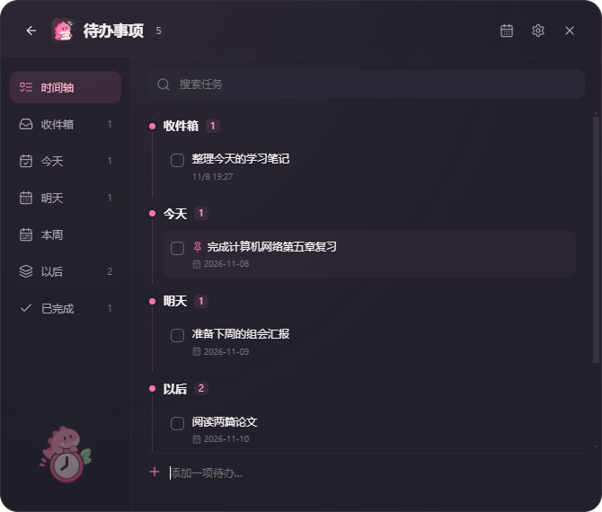

默认 Ctrl+Shift+G 唤出待办，同一快捷键再次隐藏；旧用户保留原自定义值。窗口右上角列表按钮、托盘“查看待办”同样可进入。顶部显示全部未完成数量，搜索不改变总数。

左侧包含时间轴总览，以及收件箱、今天、明天、本周、以后、已完成；各项显示数量。任务按本地日期动态分组，运行中每分钟刷新当前日期，重启不会把计划日期按 UTC 错位。

| 分组 | 规则 |
|---|---|
| 收件箱 | 没有计划日期、且未标记“以后”的未完成记录；新任务默认进入这里 |
| 今天 | 计划日期为今天或更早，逾期任务保留并标记“已逾期” |
| 明天 | 本地日期的下一天 |
| 本周 | 在明天之后、且不晚于本周日；星期一为一周起点 |
| 以后 | 下周及更远日期，或手动选择“以后”的无日期任务 |
| 已完成 | 所有完成记录，保留完成时间、原计划日期与其他字段 |

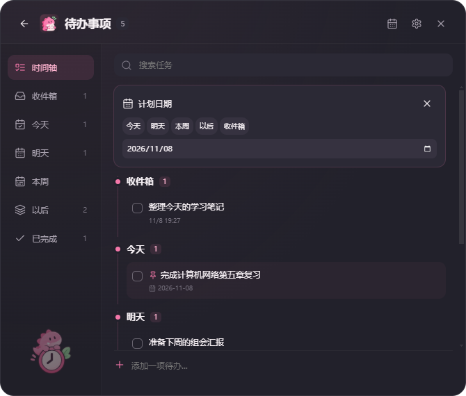

悬停任务的日历按钮或右键“计划日期”打开选择器：今天、明天、本周、自定义年月日、以后和收件箱。选择“本周”将计划日期设为本周日；选择收件箱或以后会清除明确日期。任务数据中日期格式 YYYY-MM-DD，不采用可能跨时区偏移的午夜 UTC 时间戳。

## 5. 任务管理完整清单

- 新建：快速记录输入框或列表底部输入，Enter 提交。
- 编辑：悬停铅笔或右键“编辑”，原文字进入输入框，Enter 更新原任务而不是新增。列表编辑时可点关闭图标取消。
- 复制：悬停复制图标或右键“复制”，写入系统剪贴板。
- 删除：悬停垃圾桶或右键“删除”，出现可点击撤销 Toast。
- 完成/取消完成：左侧勾选框或右键菜单；记录完成时间并保留日期和置顶等字段。
- 重要置顶：悬停图钉或右键菜单切换，粉色图钉识别，在所属时间分组内优先展示，不改变日期。
- 排序：组内置顶优先，再按计划日期、创建时间倒序和 ID 稳定排序。
- 搜索：按文字包含匹配，英文不区分大小写，同时过滤未完成与完成项。
- 已完成：总览底部默认折叠，点击展开；左侧“已完成”也能查看。
- 右键菜单：编辑、置顶、计划日期、复制、删除、完成状态。
- 平滑反馈：任务新增淡入、完成颜色变化、删除淡出，避免强烈弹跳。

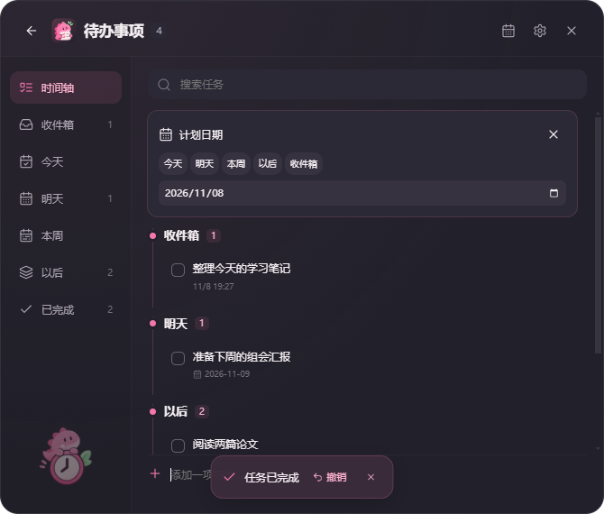

完成或删除后，底部 Toast 持续约 4.5 秒，点击“撤销”恢复完整记录快照，包括自定义日期、置顶状态、旧分类、完成时间等。Ctrl+Z 支持最近一次完成/删除撤销；文本输入控件聚焦时优先保留正常文本撤销。撤销只有一层、仅在当前会话有效。Toast 消失后快捷键仍可撤销最近一次操作，直至被下一次可撤销操作替换或程序退出。

## 6. 设置：外观、快捷键、行为、数据、关于

设置采用左侧导航，修改即时生效，无统一的大保存按钮。

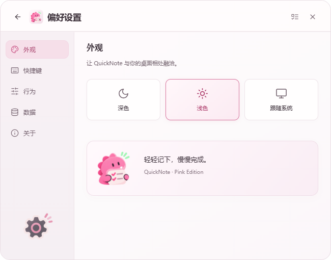

外观：深色、浅色、跟随系统；品牌粉色贯穿卡片、时间节点、开关、选择态和提示。暂不提供字号/透明度自定义。

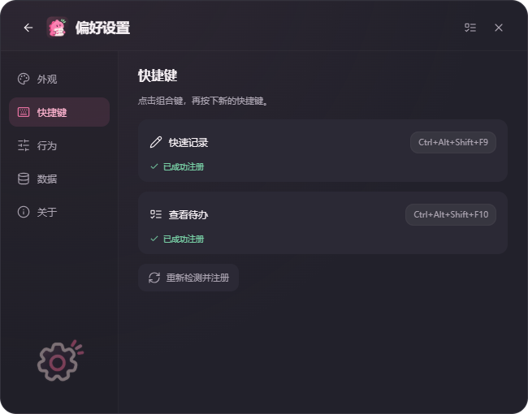

快捷键：快速记录、查看待办分别录入，点击后按组合键；Esc 取消录入。拒绝 Alt+Space（保留给 Flow Launcher），拒绝两个入口用相同组合键。注册失败提示并尝试恢复旧快捷键。“已成功注册”需要本次注册成功且 Electron globalShortcut.isRegistered 为真；冲突显示黄色，注册错误显示红色。提供“重新检测并注册”按钮。截图使用专用测试组合键，默认值仍为 Ctrl+Shift+Space / Ctrl+Shift+G。

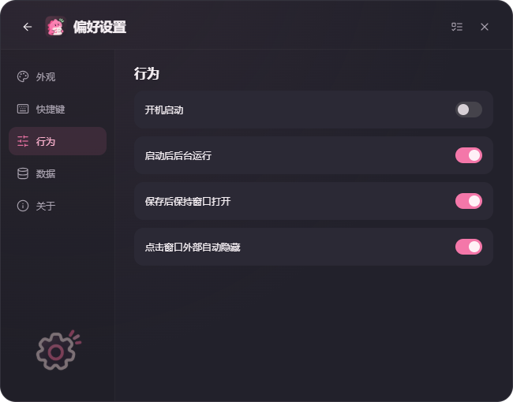

行为：开机启动、启动后后台运行、保存后保持窗口打开、点击窗口外部自动隐藏。开机启动读取真实 Windows 登录项；使用 --background 参数登录后台启动。默认后台运行、保存后保持打开、失焦隐藏开启。

数据：

1. 导出：全部任务、完成记录、设置、草稿、dataVersion:4，一并导出 JSON。
2. 导入：校验后展示记录数量，确认后按 ID 合并任务；相同 ID 采用导入记录，保留当前设置与草稿。
3. 从备份恢复：默认打开自动备份目录，也可选择之前导出的 JSON；校验版本、ID、任务、日期、草稿，显示任务及完成数量，确认后替换任务/草稿/设置。
4. 恢复前备份当前文件；文件写入失败时保持/回滚原状态，快捷键注册失败时不应用新数据。
5. 每个本地日期最多自动创建一份快照，保留最近七份，首次运行/后续写入时检查；不是每次修改都新建备份。
6. 显示最近备份日期；备份失败在数据页提示。
7. 打开保存位置，通过 Windows 文件资源管理器定位数据文件。
8. 文件选择取消、格式错误、操作成功都有反馈；确认对话框默认取消。

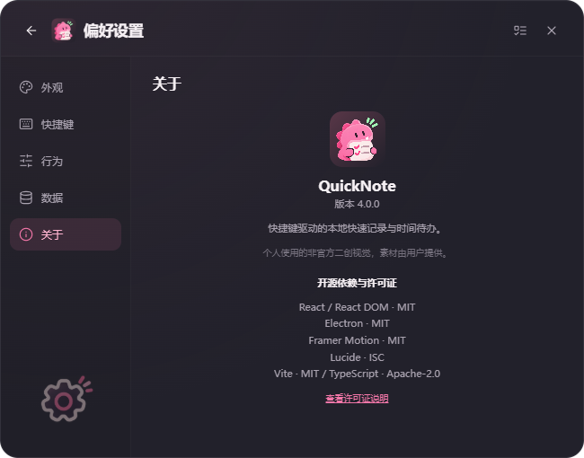

关于：应用图标、实际版本、产品介绍、个人非官方二创视觉说明、主要依赖与许可证。许可证入口打开实际包含许可证文本的原生对话框。

## 7. 托盘、图标与窗口生命周期

主图标基于用户提供的独立抱清单小龙素材，叠加深色圆角底。托盘采用简化小龙头像 SVG，避免 16px 时缩成一团。应用和托盘均提供多尺寸 PNG/ICO，菜单使用统一柔粉 Lucide 线性图标。

托盘右键菜单：快速记录、查看待办、设置、开机启动、退出 QuickNote。前两项右侧显示用户当前快捷键；开机启动显示真实状态。左键打开快速记录。上面的托盘配图是实际资产预览，不是原生菜单截图。

关闭窗口只隐藏；退出菜单才结束程序。防止重复启动，二次启动唤出已有实例。退出时清理 IPC、托盘、快捷键和隐藏定时器。无边缘吸附、悬浮球、胶囊、自由拖动或鼠标悬停唤出，不保留旧入口。

## 8. 数据结构与安全

仍使用 Electron userData 下 notes.json，通常 %APPDATA%\quicknote\notes.json，实际以设置中“打开保存位置”为准。保留 text/created/done/kind/category 及额外旧字段；新增 updatedAt/completedAt/dueDate/isPinned/schedule 等可选字段。旧任务无日期则进入收件箱，不删除旧备忘录或分类。

写入路径：临时文件 → fsync → 保留 .bak → 重命名。成功提交新任务与清除草稿同一份 JSON 写入。升级前生成 .pre4-backup；恢复前生成 .before-restore；导入前生成 .before-import。每日快照位于 backups/YYYY-MM-DD.json。

主文件无法解析时尝试 .bak；两者都失效会阻止继续启动并提示，保留原文件，不以空数据覆盖。定期导出仍然必要，备份不是无限期历史。

安全：contextIsolation 开启，nodeIntegration 关闭，Renderer 不接触 Node；preload 白名单 IPC；统一 Store 层校验任务、日期、ID 和数据版本；禁止新窗口与页面导航；无需后台鼠标轮询。

## 9. 实际验证与待验收项

已通过 TypeScript/Vite 构建；Node 数据测试验证旧数据兼容、草稿重启恢复、七份备份保留、恢复校验、本地跨年/跨周分组；Electron 实际运行检查验证唤出与焦点、草稿防抖、提交清除、连续保持打开、待办快捷键切换、完成/删除撤销并保留日期/置顶/分类、实际快捷键注册状态，以及重启草稿与旧记录保留。

截图来自独立临时数据目录，使用示例任务，不修改用户数据。全局注册回调测试不等于物理键盘跨应用验收。真实中文输入法、真实多显示器/负坐标/高 DPI、开机登录、Windows 原生菜单显示、安装流程和长期资源占用仍需人工实机验收。窗口背景当前没有 Acrylic 原生磨砂。

## 10. 源码、安装和开发

- 源码：D:\code\todo。
- 安装包：D:\code\todo\release\4.0.1\QuickNote Setup 4.0.1.exe（以实际生成结果为准）。
- 完整图标资源：assets/brand、assets/mascot、assets/icons、assets/tray、assets/app、assets/themes。用户原始素材保留在 public。
- app/app.svg 包含嵌入的用户 PNG，属于 SVG 容器，不宣称已把原始小龙自动描成纯矢量；tray 和线性操作图标为真实矢量路径。
- 测试：node --test electron/store.test.cjs；Electron electron/smoke4.cjs 及 --restart。
- 截图：electron/screenshots4.cjs。

开发命令：npm install；npm run dev；npm run build；npm run dist。NSIS 安装包未配置数字签名证书。

## 11. 后续文档更新

每次以当前功能重新核对本清单和截图，尤其是快捷键默认/自定义值、日期归类、备份数量、数据结构和实际测试范围。不擅自补写云同步、提醒、子任务、拖动吸附、多级撤销等未实现功能。

## 12. 浅色主题与图标（4.0.1）

浅色主题使用暖白窗口、淡粉侧栏、白色卡片和深玫瑰灰文字；修正旧版暗色侧栏叠加造成的灰脏背景。快捷键卡片、搜索、日期面板、输入框、勾选框与撤销提示同步适配。

新增浅色小龙图标：assets/app/app-light.svg、assets/app-light.ico 与 16～256px PNG；浅色时标题栏、关于页及原生窗口图标自动切换，跟随系统时也同步。安装程序仍保留默认品牌图标。

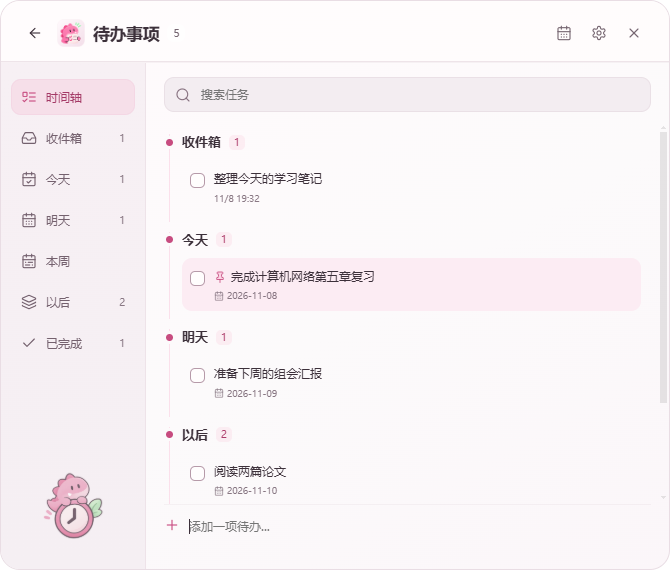

已通过生产构建并实际启动截取浅色界面；本轮未修改任务存储和日期逻辑。

## 13. 托盘菜单对齐（4.0.2）
所有功能项统一普通菜单行及16×16图标。开机启动以已开启/已关闭文字显示实际状态，点击可切换，避免原生 checkbox 项额外缩进。Electron 运行检查通过菜单类型、图标尺寸和状态文案验证，原生菜单最终视觉仍需用户环境确认。

## 14. 时间分类新增修复（4.0.3）
在今天、明天、本周、以后视图新增任务，会继承对应计划：今天/明天按提交时本地日期，本周设为本周日，以后标记为 later。收件箱、总览和快速记录仍默认无日期。编辑只改文字，保留原计划日期。本周视图包含本周的今天、明天和后续日期（4.1起不包含过去的计划），避免周末新增后消失；总览仍使用互斥时间分组。已通过 Electron 实际界面输入测试，逐项确认新增后仍出现在当前视图，并验证编辑不改变日期。

## 15. 时间与 Deadline 系统（4.1.0，当前规则）

本节替代上文旧版日期分类解释。计划日期、截止日期、提醒是独立属性，不复制任务。旧 dueDate 继续表示计划日期；新增 deadlineDate（YYYY-MM-DD）、deadlineTime（本地 HH:mm）和 reminderAt（绝对毫秒时间戳）。升级前生成 notes.json.pre5-backup，dataVersion 升至 5，旧备忘录与分类保留。

### 快速记录与统一编辑

快速记录新增收件箱、今天、明天和自选日期入口，默认仍是收件箱；设置 DDL 展开截止日期、可选时间与提醒。支持仅截止日期、仅计划日期或同时设置。最近记录之外提供今天/明天数量入口及逾期待安排提示。文字和日期选项作为草稿分别持久化，提交成功一起清除。任务详情复用相同日期控件。

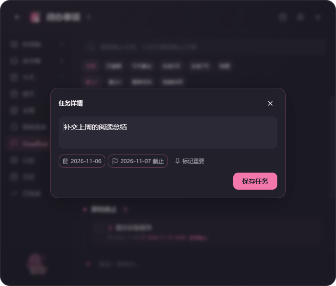

任意任务编辑入口打开统一面板：内容、计划日期、截止日期、截止时间、提醒、置顶。计划快捷选项为收件箱、今天、明天、后天、下周一、以后及自定义日期。Deadline 可清除，提醒支持不提醒、截止前1天/3小时/1小时及自定义具体时间；晚于截止时间会提示但允许保存。点击保存才应用编辑，取消不修改原任务。

### 时间轴新规则

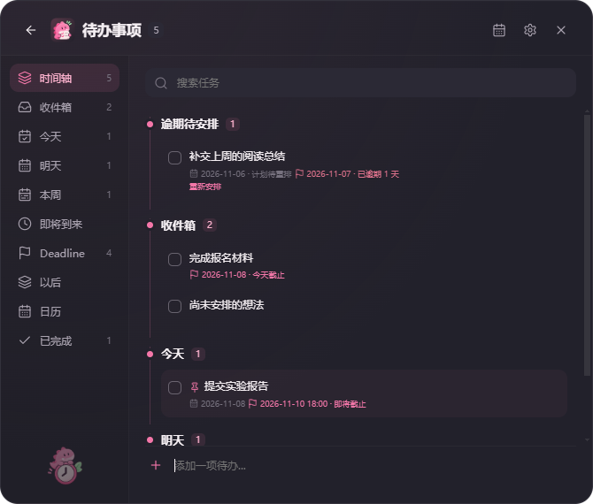

计划日期早于今天进入“逾期待安排”，不再并入今天，也不标成截止逾期；任务保留原计划日期并可重新安排。今天只包含本地今天，明天只包含本地明天。本周是今天至本周日，排除历史逾期；未来日期按具体年月日与星期分组。没有计划日期的记录进入收件箱，用户明确设为以后才进入以后。旧版未来任务落入以后的行为由“即将到来”替代。

### Deadline 智能视图

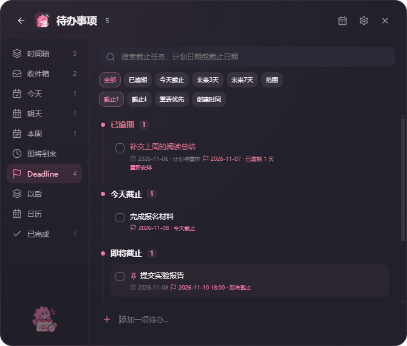

导航使用用户提供的紧急日历小龙图标，任务小标记为线性旗帜。任务设置截止日期自动进入 Deadline，清除后退出，但同一底层任务仍留在计划日期视图或收件箱。

- 未完成任务分为已逾期、今天截止、即将截止、稍后截止。
- 仅日期：截止日23:59:59.999前不逾期；具体时间：严格超过该时刻才逾期。
- 默认未来1～3自然日为即将截止，第4天起为稍后；设置可调整紧急窗口1～14天。
- 已完成截止任务默认折叠，不计入紧急数量，不显示逾期状态。
- 搜索包含任务文字、计划日期、截止日期，以及存在的 notes 备注字段。
- 可筛全部、逾期、今天、未来3天、未来7天、自定义日期范围。
- 可按截止升序/降序、重要优先、创建时间排序；默认截止日期升序，同一日期置顶优先，再按截止时间排序。
- 删除与完成仍可点击 Toast 或 Ctrl+Z 撤销，完整恢复日期、提醒与置顶信息。

### 月历

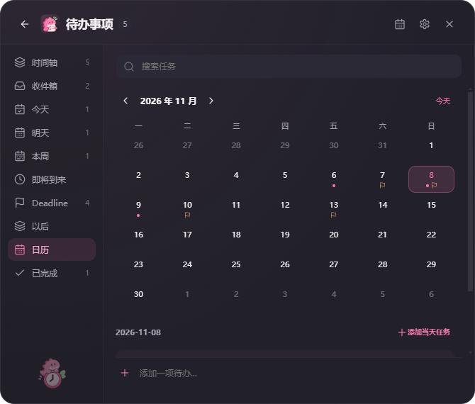

支持前后月切换与今天返回。粉色点代表计划，旗帜代表截止；同日可同时出现两种标记。选中某天后下方显示计划或截止落在该日的任务，同任务只列一次。底部直接新增时继承选中日期，也可点“添加当天任务”打开统一编辑面板。编辑任何视图中的记录都会更新同一条任务。

### 提醒设置与边界

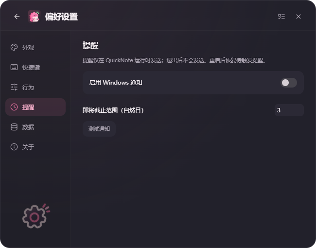

设置新增提醒分组：启用 Windows 通知、即将截止天数、测试通知。任务提醒由主进程管理，最多60秒间隔检查最早待触发时间；重启恢复未触发计划，错过的提醒在应用运行后补发。通知点击进入对应任务。已发送提醒标记持久化以避免重启重复；删除、完成、改时间或关闭通知会取消待触发提醒，已显示通知也尝试关闭。

**退出应用后不发送提醒。** 系统免打扰、权限或通知服务可能阻止显示；发送异常会保留错误说明。自动化用替身通知验证调度和去重，没有宣称真实 Windows 通知投递已完成人工验收。暂不提供重复任务、周视图、退出后的系统级调度、可配置默认提醒偏好及按项目管理。

### 浅色与验证

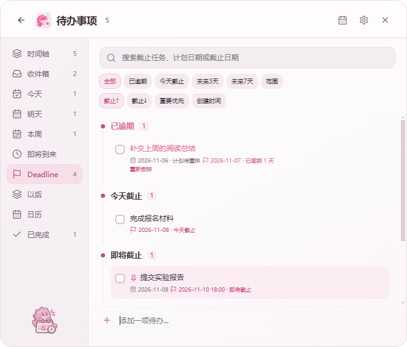

构建通过；Node测试验证计划/截止独立、当天结束边界、精确时间边界、完成状态、未来3天边界、v4迁移和提醒去重。Electron实际运行验证：同任务多视图、月历双标记与按日新增、统一编辑、清除Deadline不删任务、撤销完整元数据，以及日期草稿保存。旧的五分类新增回归检查通过。深浅主题已实际截图。

真实中文输入法、多显示器/高DPI、系统通知实际投递、开机登录和安装仍需人工实机验收。截图使用独立测试目录，没有改写用户真实记录。

当前安装包：D:\code\todo\release\4.1.1\QuickNote Setup 4.1.1.exe。运行仍为 npm run dev，构建 npm run build，打包 npm run dist。

## 16. Deadline UI 与待办新增选项（4.1.1）
主页、任务行、日期字段、日历截止标记使用与左侧 Deadline 导航相同的小龙图标，尺寸按场景调整。日期、时间、提醒字段采用统一双列/整行布局；主页移除 DDL 内层滚动，只保留整个内容区滚动，深浅主题均使用细滚动条与统一的控件配色。

待办列表底部输入后按 Enter 会先打开任务详情，点击左侧加号也可直接打开：包含内容、计划日期、截止日期/时间、提醒、置顶及保存按钮。在今天、明天、本周、即将到来、以后或选中日历日期新增时保留对应默认安排；Deadline 入口默认当天截止，可修改或清除，明确保存后才创建。主页仍直接 Enter 保存，不强制弹窗。

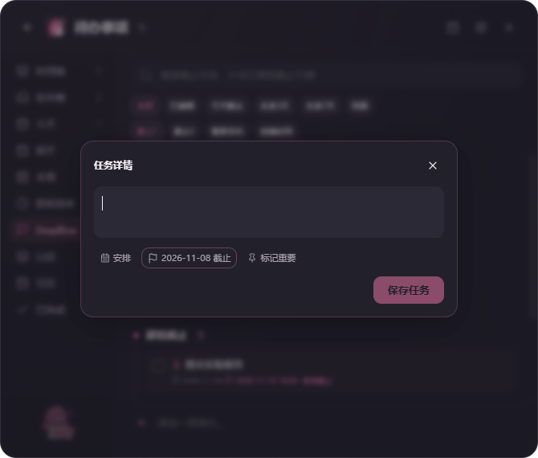

生产构建通过，实际 Electron 测试验证五个时间分类的新建面板与保存归属、日历新建、Deadline 同记录引用和撤销完整字段。截图来自独立测试目录。
