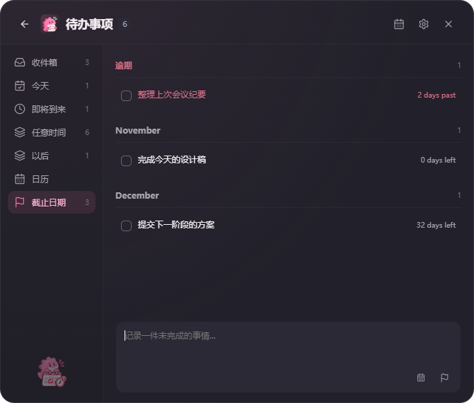
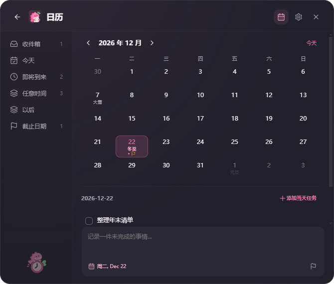

<div align="center">
  
  <h1>QuickNote</h1>
  <p><strong>轻轻记下，慢慢完成。</strong></p>
  <p>为 Windows 打造的极简桌面记录与待办工具。<br />一个快捷键，接住灵感，也安排下一件要做的事。</p>
  <p>
    <a href="https://github.com/Yfanx/QuickNote/releases/latest">下载安装</a> ·
    <a href="#快速开始">快速开始</a> ·
    <a href="#本地开发">本地开发</a> ·
    <a href="https://github.com/Yfanx/QuickNote/issues">反馈问题</a>
  </p>
  <p><code>Windows 10 / 11</code> &nbsp; <code>本地存储</code> &nbsp; <code>无需账号</code></p>
</div>

<br />

<p align="center">
  
</p>

## 随手记录，随时继续

QuickNote 把快速输入和任务整理放在两个恰好的空间里：需要记录时，唤出小巧的输入窗口；需要安排时，打开完整待办列表。深石墨色界面、克制的粉色点缀，以及陪伴在角落的小龙，让日常记录轻松一点。

### 一个快捷键，开始记录

按下 **Ctrl + Shift + Space**，直接输入。Enter 保存后即可继续下一条，Shift + Enter 支持换行。文字草稿与日期选项保存在本地，下次打开接着写。

### 给事情安排时间，也留一点余地

计划日期决定什么时候做，Deadline 表示最晚什么时候完成，两者独立设置。今天、今晚、任意日期，或先放到 Someday，都可以从输入框旁边轻松选择。

选好日期后，简短标签显示在输入框左侧；截止任务显示剩余或逾期天数，时间信息一眼可见。

### 用清晰的列表，找到下一件事

| 视图 | 用途 |
| --- | --- |
| 收件箱 | 收下还没安排的事情 |
| 今天 | 专注今天的安排 |
| 即将到来 | 浏览未来日期的任务 |
| 任意时间 | 汇总所有未完成事项 |
| 以后 | 存放暂时不打算开始的事情 |
| 截止日期 | 集中查看带 Deadline 的未完成任务 |

任务支持编辑、复制、置顶、完成、删除与单步撤销。搜索帮助快速定位，分类和浏览位置会被记住。

<p align="center">
  
</p>

### 在月历里，看见安排

右上角的日历入口，让列表和月历随时切换。计划日期与截止日期分别标记，也可以选中一天直接添加任务。

月历包含农历信息、传统节日与二十四节气，离线计算。普通日期保持干净，悬停可查看详细信息；节日标注不代表官方放假或调休安排。

<p align="center">
  
</p>

## 适合自己的桌面节奏

- **两种入口**：快速记录保持轻巧，待办窗口提供任务栏入口，托盘随时可用。
- **外观偏好**：深色、浅色与跟随系统，自定义输入框占位文字。
- **使用偏好**：自定义全局快捷键、默认打开页面与开机启动。
- **本地优先**：任务和设置存储在电脑上，支持 JSON 导入导出、自动备份与恢复；无需注册，不上传任务内容。

## 快速开始

从 [下载页面](https://github.com/Yfanx/QuickNote/releases/latest) 获取 Windows x64 安装包，运行安装后即可使用。

| 快捷键 | 操作 |
| --- | --- |
| Ctrl + Shift + Space | 显示 / 隐藏快速记录 |
| Ctrl + Shift + G | 显示 / 隐藏待办事项 |
| Enter | 保存记录 |
| Shift + Enter | 输入换行 |
| Ctrl + Z | 撤销最近一次支持撤销的任务操作 |

全局快捷键可在设置中修改；已有安装保留个人快捷键配置。关闭窗口后，QuickNote 继续驻留系统托盘，可通过托盘菜单退出。

## 本地开发

基于 **Electron · React · TypeScript · Vite** 构建，使用 Framer Motion 处理界面动画，JSON 保存本地数据，electron-builder 生成 Windows NSIS 安装包。

```bash
npm install
npm run dev
```

```bash
npm run build   # 类型检查与前端构建
npm test        # 单元测试与 Electron 回归检查
npm run dist    # 生成 Windows 安装包
```

安装包输出到 `release/` 下的版本目录。自动化测试使用独立临时数据，不修改日常记录。测试范围见 [测试报告](docs/TEST_REPORT.md)，Windows 实机检查见 [Windows 验收说明](docs/WINDOWS_ACCEPTANCE.md)。

### 数据与项目结构

本地数据通常位于 `%APPDATA%/quicknote`，也可以在设置中定位。导入与恢复前会保留备份，自动快照保留最近七份。

```text
electron/   窗口、托盘、快捷键与本地存储
src/        React 界面、日期交互与主题样式
assets/     应用图标与桌面资源
public/     品牌素材
tests/      单元测试与桌面交互检查
docs/       界面截图与验证文档
```

第三方依赖的许可证与声明见 [THIRD_PARTY_NOTICES.md](THIRD_PARTY_NOTICES.md)。

---

<p align="center">留住眼前的想法，专注接下来的行动。</p>
