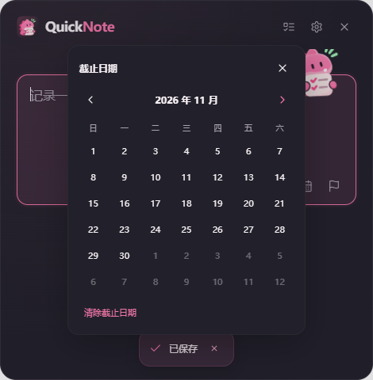

# QuickNote

Windows 本地快速记录与时间待办工具。Electron + React + TypeScript + Vite，无账号和云同步。当前版本 **4.2.0**。


## 使用

- Ctrl+Shift+Space 唤出快速记录，Ctrl+Shift+G 打开待办；再次按相同快捷键隐藏，旧配置保留。
- Enter 保存、Shift+Enter 换行，输入法组合保护，草稿与日期选项本地保存。
- 首页输入框右下角日历/旗帜打开 When 与 Deadline。When 支持今天、今晚、展开月历和下一个周日，Deadline 首页只选日期。
- 首页移除数量标签与最近记录；待办分类为收件箱、今天、即将到来、任意时间、以后、日历、截止日期。即将到来涵盖所有未来日期。
- 待办 Enter 或加号打开完整任务详情，默认继承当前分类日期。
- 计划日期与截止日期独立；时间轴、Deadline 与月历引用同一条任务。
- 左侧 Deadline 集中查看截止任务，支持紧急程度分组、范围筛选、搜索和排序。
- 月历分别标记计划日期与截止日期，支持按日新建。
- 编辑、复制、置顶、完成/删除、按钮与 Ctrl+Z 单层撤销。
- 深色、浅色、跟随系统主题；托盘常驻、登录启动、实际快捷键状态。
- 应用运行时提供 Windows 提醒，退出后不提醒；系统通知实际显示受 Windows 设置影响。



## 开发与打包

```powershell
npm install
npm run dev
npm run build
npm run dist
```

NSIS 输出 release/4.2.0，安装包与 node_modules/dist 均不提交 Git。未配置代码签名。图标构建：node assets/build4.cjs。

## 本地数据

沿用 Electron userData 下 notes.json，通常 %APPDATA%/quicknote，可在设置定位。dataVersion5，旧 dueDate 保留为计划日期，deadlineDate/deadlineTime/reminderAt 独立。旧备忘录和分类不删除。临时文件 + fsync + 重命名，滚动 .bak、升级 .pre5-backup、导入/恢复前备份；每日最多一份快照，保留最近七份。恢复有结构校验和确认。

## 验证

```powershell
node --test tests/deadline.test.cjs tests/reminders.test.cjs tests/store.test.cjs
node_modules/.bin/electron tests/popover-smoke.cjs
node_modules/.bin/electron tests/deadline-smoke.cjs
node_modules/.bin/electron tests/schedule-smoke.cjs
```

运行测试使用独立临时目录，不修改真实记录。真实 Windows 通知、输入法、多显示器/高 DPI、开机登录及安装流程仍需人工验收。

## 文档与资源

完整的个人功能说明与历史截图保留在本地桌面，不上传仓库。assets 包含用户提供的粉色小龙品牌素材、SVG 操作图标和多尺寸 ICO。原素材及其来源说明保留；依赖许可证见 THIRD_PARTY_NOTICES.md。

## 版本管理

main 分支保留可构建版本，版本标签与 package.json 对应。4.1.1 为 Git 初始基线，4.2.0 为紧凑日期浮层与旗帜统一。远端：https://github.com/Yfanx/QuickNote 。

全功能自动化回归：npm test。范围与未实机验收项见 [测试报告](docs/TEST_REPORT.md)。
