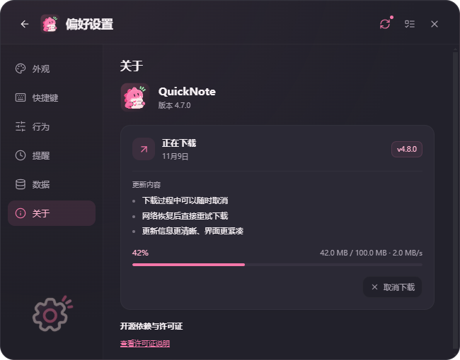
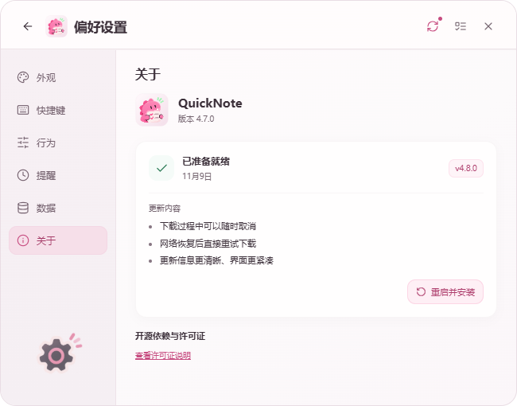

# QuickNote 4.7.0 回归测试

日期：2026-11-09。npm run build、npm test、node scripts/verify-release.cjs。所有功能测试使用隔离数据。

- 24项Node单元测试：相对日期跨年与固定日期保护、分类位置合并/校验/重启、启动项参数匹配及空格路径、存储迁移/备份、日期边界、提醒去重、更新状态与错误处理。
- 18组Electron运行检查：显示拓扑、浏览位置/跨天唤醒、开机启动、默认打开、真实HTTP更新下载及损坏包拒绝、更新UI确认、简化DDL、日期标签、When、通用功能、分类新增、截止/日历、浮层、备份恢复、托盘。
- 新交互：跨年唤醒、固定日期不变、隐藏再开今天默认日期、分类滚动/renderer重载恢复、日历月份与选中日期恢复、原记录保留。
- 原有检查：连续记录、组合输入保护、占位文字、快捷键回调切换、焦点/Esc/失焦、三主题、搜索/复制/置顶、编辑/完成/删除撤销、导入导出与确认恢复、托盘图标。
- 新增真实Windows安装/启动项/进程DPI验收见[独立报告](WINDOWS_ACCEPTANCE.md)。实机只有一块物理显示器；负坐标等场景是模拟拓扑。

没有重启或休眠用户电脑，也没有执行完整软件内更新覆盖安装。真实输入法、物理全局按键跨应用、第二块物理显示器、通知实际送达、长期资源占用仍有实机覆盖限制。测试失败分支的错误输出为预期校验，不代表整套回归失败。

## 4.6.0 更新流程验收

- 单元测试：取消后等待旧请求收尾、忽略旧进度/完成事件、直接重试不重新检查版本、下载完成与取消竞态、安装失败需再次确认、简短纯文本更新内容及长度限制。
- 真实HTTP与electron-updater：通过302重定向的慢速传输取消后，服务器确认连接提前关闭；重新下载建立新请求，唯一完整响应通过SHA512校验。损坏文件被拒绝，恢复有效内容后直接重试成功。
- Electron UI/IPC：更新内容、目标版本、日期、百分比、大小、速度、取消/已取消/重试/已就绪及深浅色；默认窗口高度内取消按钮可见，原任务未改。截图由隔离替身提供4.8.0示例。
- 原有安装确认检查保留，下载完成不会自动安装。本轮没有执行实际覆盖安装，也没有重启/休眠用户电脑。4.5.0真实Windows隔离安装记录见独立报告，不将其作为本轮安装实测。
- node scripts/verify-release.cjs核对当前ASAR源码、取消令牌运行依赖和安装包元数据/哈希。

4.7.0日历：24项单元测试、18组Electron检查覆盖新入口、返回原分类、节日/节气、闰月不重复、重合节日、日期选择和原任务保留。节气对照：[香港天文台2026公历农历表](https://www.hko.gov.hk/tc/gts/time/calendar/pdf/files/2026.pdf)。
