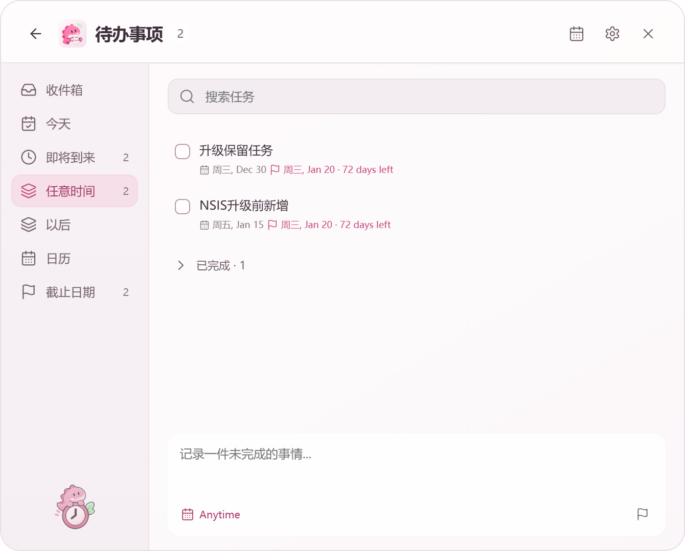

# Windows 安装与显示验收

日期：2026-11-09。Windows 10.0.26300，Electron 35.7.5。使用独立应用标识、独立数据目录和示例任务，不覆盖用户安装目录或任务。QA包仅替换应用标识并注入测试驱动，未发布到GitHub。

| 检查 | 结果 |
|---|---|
| 4.4.2 NSIS 实际安装 | 通过，当前用户安装至隔离目录 |
| 4.5.0 NSIS 覆盖升级 | 通过，版本实际更新 |
| 升级数据保留 | 原未完成、已完成及升级前新增记录逐字段一致；主题、默认打开偏好保留 |
| Windows 启动项 | 原生API注册并读取，原始Run值含完整带引号路径与--background；操作后已关闭并清理测试项 |
| 后台启动 | 按启动项中的路径和参数启动，未显示窗口，记录保留 |
| DPI | 下表实测，实际独立安装的exe，进程强制缩放，不改Windows系统显示设置 |
| 多显示器 | 当前只有一块1920×1080物理屏幕，工作区1872×1080（避让任务栏） |
| 卸载 | QA应用使用自身NSIS卸载程序清理，真实QuickNote不受影响 |

| 阶段 | 实际版本 | devicePixelRatio | 窗口大小 | 横向溢出 |
|---|---|---|---|---|
| before | 4.4.2 | 1 | 670×570 DIP | 无 |
| after | 4.5.0 | 1 | 670×570 DIP | 无 |
| dpi1 | 4.5.0 | 1 | 670×570 DIP | 无 |
| dpi1.25 | 4.5.0 | 1.25 | 671×571 DIP | 无 |
| dpi1.5 | 4.5.0 | 1.5 | 671×570 DIP | 无 |
| dpi2 | 4.5.0 | 2 | 670×540 DIP | 无 |

另用真实BrowserWindow与模拟screen拓扑检查左侧负坐标副屏、竖屏、小工作区，三个视图重新打开后均在工作区内。这不能替代两块物理显示器上的拖动/拔插验收。

未执行Windows重启、真实休眠/解锁或完整软件内“下载后安装”升级。日期恢复通过powerMonitor事件注入验证；更新下载与SHA512校验已单独测试；这里的覆盖升级实际调用NSIS安装程序。未把这些检查声称为完整硬件或登录会话验收。

复跑：先打包当前版本，并保留release/4.4.2/win-unpacked/resources/app.asar，再运行node scripts/windows-acceptance.cjs。原始报告在本地.qa目录（Git忽略）。
